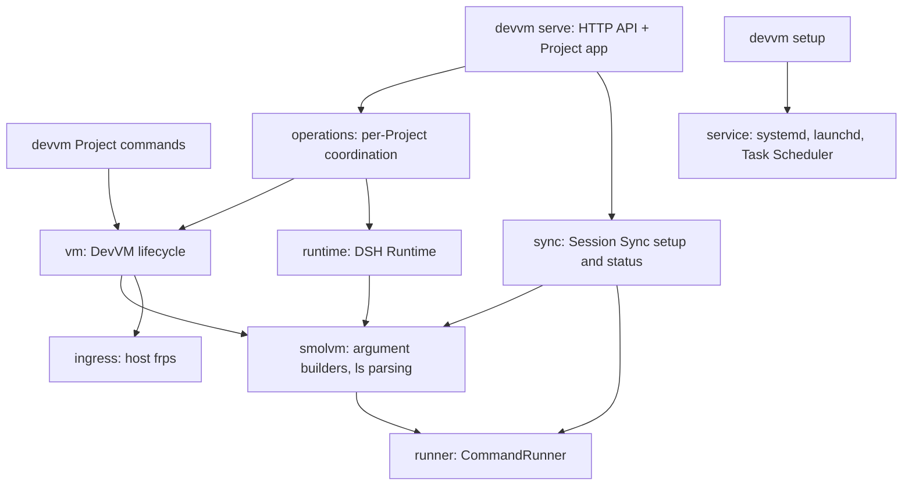

# Plan: Refactor DevVM onto Smolvm 1.27.3 with native Windows support

Status: validated

This plan supersedes `.scratch/smolvm-upgrade-windows/plan.md`. It delivers the same functionality and removes five architectural problems.

## Goal

Functionality:

1. Every DevVM runs on Smolvm 1.27.3 on Linux, macOS, and Windows x86_64 (native, using the Windows Hypervisor Platform; WSL2 is not used), with the same guest environment, Project, DSH Runtime, Project Log, Session Sync, Project URL, and remote-access behavior on all three.
2. DevVM lives in its own GitHub repository with GitHub Actions running checks on every push and publishing releases from version tags.

Architecture:

| Today | After the refactor |
|---|---|
| The daemon spawns the bash `devvm` CLI, which spawns `smolvm`; the two programs talk through text output (`Machine '<name>': <state>`, memory JSON). | One Rust binary, `devvm`. Its VM module calls `smolvm` directly; the daemon (`devvm serve`) and the Project commands (`devvm start`, ...) share that module in-process. |
| Two web UIs: the Project app at `/` and the management UI at `/manage`, with two lifecycle APIs (daemon-owned operations, and blocking requests cancelled on disconnect). | One UI, the Project app, and one lifecycle API, daemon-owned operations. |
| `setup-devvm.sh` installs Smolvm through its web installer and frps, builds the image and the daemon, and installs the service; Windows would need a second script. | Release binaries; `devvm setup` performs installation on every OS. |
| Every workstation builds a 5 GB image with Docker and imports a `docker save` tar. | CI builds a multi-architecture image per release and pushes it to GitHub Container Registry; machines are created from that image reference. |
| Settings spread across `smolvm.toml`, `projects.json`, `sync.json`, and about a dozen `DEVVM_*` environment variables and flags. | One `config.toml`; the Project registry and other state in the data directory. |

Out of scope: Windows arm64 (Smolvm ships no build); changes to the guest image contents, DSH, the Session Sync plugin, and the ingress chain (host Caddy, frps, guest frpc, guest Caddy); running the DSH plugin `node --test` suites in CI, because they need a staged DSH environment (both profiles installed, a candidate overlay, `DSH_HOME` and `DSH_PACKAGE_ENTRY`) that is not scripted today. Those suites keep running inside a DevVM, as `AGENTS.md` describes.

## Decisions

| Decision | Choice | Reason |
|---|---|---|
| Existing installations | Clean reinstall: delete every DevVM and all Smolvm 1.19.3 state, then recreate. No migration code. | The user accepts recreating VMs; Portable DSH State returns from the Sync Store. |
| Smolvm version | `1.27.3`, pinned in code. Pin a newer release instead if it fixes the virtio-net relay CPU spin ([PR #1740](https://github.com/smol-machines/smolvm/pull/1740)) and passes acceptance. | Newest release on 2026-10-13. |
| Smolvm installation | `devvm setup` downloads `smolvm-1.27.3-<platform>.tar.gz` (`linux-x86_64`, `linux-arm64`, `darwin-arm64`) or `smolvm-1.27.3-windows-x86_64.zip` and the release's `checksums.sha256`, verifies the SHA-256, and extracts the archive's top-level folder to `<data>/devvm/smolvm-1.27.3/`. `devvm` runs `smolvm` (Windows `smolvm.exe`) by that absolute path. Downloads and extraction use the system `curl` and `tar` (both ship with Windows 10 1803+; Windows `tar` extracts zip). | One code path on every OS; the installed version is the directory name, so no version detection; no dependency on Smolvm's mutable web installer. The extracted folder runs from any location: the Unix `smolvm` wrapper finds `smolvm-bin`, libraries, the agent rootfs, and the compressed disk templates beside itself, and the macOS entitlement is part of the signed binary. |
| frps | Pinned `0.71.0`, the same version as the guest's frpc (`Dockerfile:6`). `devvm setup` downloads `frp_0.71.0_<os>_<arch>.tar.gz` (Windows `frp_0.71.0_windows_amd64.zip`) and installs `frps` into `<data>/devvm/bin/`. Arguments stay `--bind-addr 127.0.0.1 --bind-port 17007 --proxy-bind-addr 127.0.0.1 --vhost-http-port <ingress_port> --vhost-http-timeout 1800`. | Unchanged ingress behavior. |
| Shared guest config (`root/`) | Stays in the repository. Each workstation clones the repository (with `core.symlinks=true`) and gives `devvm setup --root-dir <clone>/root` once; setup fails if `root/.dsh/profiles/web/package.json` or `headless/package.json` is missing. | `root/` holds the DSH profiles, plugins, skills, and settings mounted at `/devvm-root`; it is not part of the image or the binary. |
| Machine queries | `smolvm machine ls --json`, once per status refresh for all Projects. | One call answers existence, state, `pid`, and `memory_mib` for every machine. An absent machine is simply missing from the list, while `machine status --json` exits 1 for a missing machine and for real failures alike. Both commands run Smolvm's orphan cleanup first, so neither is side-effect free; neither starts a machine. |
| Guest image | Published as `ghcr.io/risakirisu/devvm:<version>` (and `:latest`) for `linux/amd64` and `linux/arm64`, version equal to the `devvm` release. The package is public. `vm.image` in `config.toml` may name another reference or a local `docker save` tar for image development. | The binary and image release together, so they always match. A public package needs no credentials on workstations; the image contains only public tools and this repository's scripts and patches. Smolvm selects the host architecture from the multi-architecture manifest and the guest pulls the image on a machine's first start. |
| Repository | New private GitHub repository `RisaKirisu/devvm`, created from `coding-config/dev-vm` with its history. | The repository holds personal configuration (domain, Tailscale address, skills). |
| Process boundary for tests | The mockall `CommandRunner` seam moves from `devvm` to `smolvm`, `ssh`, and (Windows) `schtasks` commands. | It stays the one place where external commands are described and asserted. |

## Target architecture



Every module receives the loaded configuration; none reads environment variables.

| Module | Responsibility |
|---|---|
| `config` | Load and validate `config.toml` (fail on unknown keys or missing required values); resolve the data directory; update supplied keys with `toml_edit`, which keeps the rest of the file and its comments. |
| `project` | Project identity (name, hash, Project host, machine name) and the registry `projects.json`. |
| `smolvm` | The Smolvm CLI boundary: path to the pinned binary, argument builders for `machine create/start/stop/delete/exec/ls`, parsing `ls --json`. |
| `vm` | DevVM lifecycle: create, start (with guest setup), stop, delete, state, memory. |
| `ingress` | Ensure the host frps is running. |
| `runtime` | DSH Runtime launch, stop, probe (guest snippets, unchanged behavior). |
| `operations` | Per-Project operation coordination (today `lifecycle.rs`), with only the submitted-operation path. |
| `sync` | Session Sync provisioning (one function used by `devvm sync setup` and `/api/sync/setup`) and status. |
| `logs`, `browser` | Unchanged responsibilities. |
| `api`, `web/` | HTTP API and the Project app. |
| `service`, `setup` | Service registration; `devvm setup`. |
| `runner` | `CommandRunner` and the platform-specific process capture and cancellation. |

### Command line

| Command | Purpose |
|---|---|
| `devvm setup [--root-dir PATH] [--remote-domain D] [--remote-ip IP] [--service]` | Check prerequisites, install Smolvm and frps, create `config.toml` (`--root-dir` required then) or update the keys given, and print the host Caddy block (`scripts/Caddyfile.host`, embedded with `include_str!`) with its environment settings when a remote domain is configured. `--service` registers and starts the service. |
| `devvm serve` | Run the Control Daemon. Settings come from `config.toml`. |
| `devvm service install\|status\|uninstall` | Manage the user service. `install` registers, enables, and starts it (today's `--enable` and `--start` become the only behavior); the registered command is `<absolute devvm path> serve`, plus `--config <path>` when a non-default config is used. |
| `devvm sync setup --ssh-user U --ssh-host H --ssh-key K [--ssh-port P] [--remote-root R] [--no-verify]` | Provision Session Sync with today's flags (`src/main.rs:100-129`); `--ssh-key` stays required. Today's `--config-path` and `--port` are replaced by the global `--config` and `server.port`. |
| `devvm start\|shell\|exec\|stop\|status\|memory\|rm\|name` | Project commands, run in a Project directory; `shell` is the default. `memory` prints `{"host_bytes":…,"guest_bytes":…,"limit_bytes":…}` as today. |

A global `--config <path>` selects the `config.toml` to use; tests use it.

### Configuration and state

`<config dir>/devvm/config.toml` (`dirs::config_dir()`):

```toml
root_dir = "/home/me/devvm/root"   # shared guest config, mounted at /devvm-root

[server]                            # optional; defaults shown
host = "127.0.0.1"
port = 8100
ingress_port = 8102

[vm]
cpus = 16
memory_mib = 8192
storage_gib = 50
# image = "ghcr.io/risakirisu/devvm:0.3.0"   # optional override

[remote]                            # optional
domain = "risak.dev"

[sync]                              # written by `devvm sync setup`
ssh_user = "devvm"
ssh_host = "vps.example"
ssh_port = 22
ssh_key = "/home/me/.ssh/id_ed25519"
remote_root = "/var/lib/devvm-sync"
```

- `[server]` replaces the `serve` and `service install` flags `--host`, `--port`, and `--ingress-port`, and `[remote].domain` replaces `--remote-domain` (`src/main.rs:55-75,132-157`); frps's bind port 17007 stays a constant because the guest's `scripts/frpc.toml` names it.
- `<data dir>/devvm/` (`dirs::data_dir()`) holds `projects.json`, `smolvm-1.27.3/`, `bin/frps[.exe]`, `frps.log`, and (Windows) `run/`.
- Project Logs stay in `<root_dir>/.project-logs/<project-id>/`, where the guest writes `dsh.log`, `ingress.log`, and `dsh.token`.
- Session Sync provisioning writes `[sync]` and the guest-visible `<root_dir>/.config/devvm/sync.json` with `ssh_user`, `ssh_host`, `ssh_port`, `ssh_key_path` (`/root/.ssh/<key file name>`, the key copied into `<root_dir>/.ssh/`), `remote_sync_root`, the existing `writer_id` kept or a new one minted, and `daemon_url` `http://127.0.0.1:<port>` (`src/sync.rs:112-162`). The daemon reads `config.toml` when it needs sync settings, so `/api/sync/config` reflects a `devvm sync setup` immediately.
- Removed: `smolvm.toml`, `smolvm.toml.example`, the host-side `DEVVM_*` setting variables, and the matching path flags: `serve --config` (registry path), `--log-dir`, `--home-dir`, `--devvm-bin`, `service install --bin-path`, and `sync setup --config-path`. The variables `devvm` passes into the guest stay: `DEVVM_PROJECT_HOST` (`scripts/frpc.toml:5`) and `DEVVM_EMBED_PROJECT_ID`, `DEVVM_CONTROL_ORIGINS`, `DEVVM_CONTROL_DOMAIN` (`src/runtime.rs:23-25`).
- Machines are created with `--cpus`, `--mem`, `--storage`, `--net --net-backend virtio-net`, and `--workdir /root`; Smolvm stores them with the machine.

## Phase 0: Own repository and continuous integration

1. Create the repository (the user creates the empty private `RisaKirisu/devvm` on GitHub):
   ```sh
   git clone git@github.com:RisaKirisu/coding-config.git devvm && cd devvm
   git filter-repo --subdirectory-filter dev-vm
   git remote add origin git@github.com:RisaKirisu/devvm.git
   git push -u origin main
   ```
   `git filter-repo` rewrites history so that only `dev-vm/` remains, as the new root. Keep `coding-config/dev-vm` until the clean reinstall after Phase 1 has removed the old installation, because its `devvm` and `setup-devvm.sh` perform that cleanup; then remove it.
2. Add `.github/workflows/ci.yml`, triggered on pushes and pull requests, with job `test-linux` on `ubuntu-24.04`: `cargo fmt --check`, `cargo clippy --all-targets -- -D warnings`, `cargo test`. Later phases add `test-macos` (Phase 1) and `test-windows` (Phase 4).
3. Add `.gitattributes` forcing LF for `Dockerfile`, `scripts/**`, `patches/**`, `root/**`, `*.sh`, `*.toml`.
4. Update `AGENTS.md` and `readme.md` paths that mention `coding-config/dev-vm`.

Acceptance: the repository builds from a fresh clone; a push shows `ci` passing in the Actions tab.

## Phase 1: Single binary, Smolvm 1.27.3, one configuration (Linux and macOS)

1. Rename the binary to `devvm`; move `devvm-daemon` subcommands under it (`serve`, `service`, `sync setup`).
2. Add `config`. Remove `DaemonConfig::new()`'s environment lookups (`src/config.rs:28-75`) and `devvm_root()`'s (`src/sync.rs:81-89`); tests construct the config directly, which removes the process-wide environment races recorded in `.agents/lessons.md`.
3. Add `project` with the identity from `src/models.rs:172-209`, split into name, hash, Project host, and machine name `dev-<name>-<hash>`.
4. Add `smolvm` and `vm`, porting the bash `devvm` behavior:
   - `start`: create the machine if absent (`--image`, resources, `-e DEVVM_PROJECT_HOST=<host>`, `-v <project>:/root/workspace`, `-v <root_dir>:/devvm-root`), start it if not running, then run the guest setup (ingress, `link-root`, `/storage/tmp` cleanup with `fstrim`, cache-reclaim loop) only when a start happened.
   - Guest snippets move to `scripts/guest/*.sh`, embedded with `include_str!`. In `link-root`, delete the migration of old `/root/.dsh` contents and the old-symlink removal (`devvm:168-180`) and the skips when `dsh` or a profile `package.json` is missing (`devvm:195-200`); keep the lockfile staleness check.
   - State from `ls --json`: `running` → Running; `created`, `stopped` → Stopped; any other state → Failed.
   - Memory: host bytes from the `pid` in `ls --json` (`sysinfo` resident memory), guest bytes from `/proc/meminfo` in the guest (`MemTotal - MemAvailable`), limit from `memory_mib`; each is absent when unavailable.
5. Add `ingress`: reuse a current-user frps process whose executable and arguments match; otherwise start `<data>/devvm/bin/frps` detached with output appended to `<data>/devvm/frps.log`.
6. The daemon calls `vm`, `runtime`, and `sync` directly. Delete `Devvm` in `src/runner.rs`, the text parsers `parse_vm_status` and `parse_vm_memory`, and the bash `devvm`.
7. Add `setup` (Smolvm and frps installation, the Linux `/dev/kvm` access check, the `root/` manifest check, config creation and update, service registration). Delete `setup-devvm.sh` and `build.sh`; `readme.md` documents the local image build, used through `vm.image` until Phase 2 publishes images:
   ```sh
   docker build -t devvm-image . && docker save -o devvm-image.tar devvm-image
   ```
8. Tests: the mockall suites assert `smolvm` commands (program = pinned Smolvm path, arguments, guest snippet) instead of `devvm` commands; `tests/common/mod.rs` gains helpers for `ls --json` output. Unit-test argument builders, identity (including a `--` name and a name over 48 characters), state mapping, memory with missing values, config validation and key updates, sync provisioning (host and guest files, kept `writer_id`), checksum verification, and archive names. `tests/install_test.rs` keeps only what remains (plugin/profile checks, service file generation). `tests/observability_test.rs:122-148` tests a failed command spawn through the daemon: point the config's data directory at a tree whose `smolvm` is a non-executable file and keep the tracing and Project Log assertions.
9. Add `test-macos` on `macos-15` to `ci.yml`.
10. Docs: `readme.md` (installation, CLI, config, files), `AGENTS.md` (Smolvm pin, `CommandRunner` paragraph, removal of the `devvm`/`setup-devvm.sh` named-function rule), `docs/remote-access.md`, `docs/dsh-runtime-maintenance.md`.

Clean reinstall (the user performs it once, after Phase 1). Steps 1–3 use the old installation from the untouched `coding-config/dev-vm` checkout, whose `devvm` is symlinked into `~/.local/bin` (`setup-devvm.sh:188-189`):

1. In each Project, confirm Sync Status `synchronized`; for a Project without a Sync Store, copy `/var/lib/devvm-dsh` out of the guest first.
2. With the old tools: `devvm rm` in every Project; `devvm-daemon service uninstall`.
3. Remove `~/.smolvm` and Smolvm's state: the `smolvm` directory under the data root and the `smolvm`, `smolvm-image-archives`, `smolvm-pack`, `smolvm-libs` directories under the cache root (Linux `$XDG_DATA_HOME` default `~/.local/share` and `$XDG_CACHE_HOME` default `~/.cache`; macOS `~/Library/Application Support` and `~/Library/Caches`; on Linux with `SMOLVM_DATA_DIR`, the same paths under it). Remove `~/.config/devvm/` and `~/.local/bin/devvm*`.
4. Install the new `devvm`, run `devvm setup --root-dir <clone>/root --service [--remote-domain ...]`, then `devvm sync setup ...`.
5. Register each Project in the Project app (its `.devvm-id` keeps its Project ID), start its DevVM and DSH Runtime; startup reconciliation pulls Portable DSH State from the Sync Store.

Acceptance (Linux x86_64 and macOS arm64):

- CI passes, including `test-macos`.
- The opt-in `tests/live_acceptance_test.rs` passes (rewritten for the `devvm` binary).
- A new DevVM survives two stop/start cycles with its guest files intact.
- In the guest: both shares mounted read-write; `/root/.dsh` bind mounts present; `/sys/fs/cgroup/memory.reclaim` writable; `fstrim /storage` succeeds; the cache-reclaim loop survives the exec that started it.
- `devvm exec -- false` exits 1; `devvm exec -- sh -c 'exit 3'` exits 3; `devvm shell` is interactive; `devvm name` prints `dev-<name>-<hash>`.
- Guest frpc reaches host frps through `100.96.0.1:17007`; Project URLs serve locally and remotely, including for a Project directory named with `--`.
- After the reinstall, a Project's DSH sessions return from the Sync Store.
- Host memory reported for a DevVM falls after guest cache reclaim.
- A DevVM with three mounts and virtio-net boots.
- The VM process does not stay at high CPU after DSH and frpc connections close (#1740).

## Phase 2: Release automation

Add `.github/workflows/release.yml`, triggered by tags `v*`:

| Job | Runner | Work |
|---|---|---|
| `binaries` (matrix) | `ubuntu-24.04`, `ubuntu-24.04-arm`, `macos-15` | Check the tag equals `v` + `Cargo.toml` version; `cargo build --release`; upload `devvm-<target>` as a workflow artifact. Phase 4 adds `windows-2025`. |
| `image` (matrix) | `ubuntu-24.04` (amd64), `ubuntu-24.04-arm` (arm64) | Log in to `ghcr.io` with `GITHUB_TOKEN`; `docker buildx build` the Dockerfile natively and push by digest to `ghcr.io/risakirisu/devvm`; upload the digest as an artifact. Print `df -h` before and after; if the 14 GB runner disk is too small, delete unused preinstalled toolchains first. |
| `image-manifest` | `ubuntu-24.04`, needs `image` | `docker buildx imagetools create -t ghcr.io/risakirisu/devvm:<version> -t ghcr.io/risakirisu/devvm:latest` from the two digests. |
| `release` | `ubuntu-24.04`, needs `binaries` and `image-manifest` | `gh release create <tag> --verify-tag --generate-notes` with the binaries and a `SHA256SUMS` file, with `GH_TOKEN: ${{ github.token }}`. |

Permissions: the image jobs get `contents: read` and `packages: write`; `release` gets `contents: write`. Declaring any permission sets the others to none, and a private repository needs `contents: read` to check out. After the first release, set the `devvm` package to public in its package settings.

Code: the default `vm.image` becomes `ghcr.io/risakirisu/devvm:<CARGO_PKG_VERSION>`. `readme.md` documents installation as cloning the repository and downloading the release binary for the OS with `curl` (or `Invoke-WebRequest` on Windows; a browser download would mark the unsigned macOS binary for Gatekeeper), then running `devvm setup`.

Acceptance: tagging `v<version>` produces a release with three binaries and a multi-architecture image; a new DevVM created on Linux and macOS from the default image passes the Phase 1 guest checks.

## Phase 3: One UI and one lifecycle API

1. Build the remaining `/manage` functions into the Project app, using the existing endpoints:
   - Register a Project through the Project Browser (`/api/browser`, `/api/projects/register`) and unregister it.
   - Per Project: memory usage, Project ID and Project host, separate local and remote DSH links (`src/ui.rs:769-801`), and opening a guest port (`/api/projects/{id}/open-port`).
   - Session Sync: view and run setup (`/api/sync/config`, `/api/sync/setup`) and delete a Project's Sync Store data (`/api/projects/{id}/sync/delete`).
   - Logs: source filters, errors only, and Follow (`src/ui.rs:1071-1098`); the app already has Restart DSH and log refresh.
2. Delete `/manage` and `MANAGEMENT_HTML` in `src/ui.rs`, the management dialog in the app (`src/web/app.js:618-622`, `index.html`), the blocking lifecycle routes (`/api/projects/{id}/vm/*`, `/dsh/*`), `DshRuntimeManager::execute`, and `Operations::run` with its disconnect cancellation (`src/lifecycle.rs:133-155`).
3. Tests: replace the disconnect-cancellation tests in `tests/lifecycle_test.rs` and the legacy-route tests in `tests/api_test.rs` with operation tests (conflicting submissions return 409; Stop VM, Delete VM, and Stop DSH cancel an active start and wait for process cleanup; two clients see the same active and latest operation). Extend the Project app browser checks (`tests/project_app_controls.cjs`, `tests/project_app_mobile.cjs`) to the new panels.
4. Docs: `readme.md` (Control Daemon & Web UI), `docs/project-app.md`, and `AGENTS.md` (the lifecycle cancellation paragraph describes operation cancellation only).

Acceptance: CI passes; every function listed in step 1 works in the Project app on desktop and mobile layouts; `/manage` returns 404.

## Phase 4: Native Windows

1. Platform code:
   - Process handles: at startup on Windows, `devvm` clears the inherit flag on its own standard handles (`SetHandleInformation`), and `runner` captures each command's stdout and stderr through files in `<data>/devvm/run/`, read after exit. Rust's Windows process spawn passes every inheritable handle to the child, so a detached child (Smolvm's VM process, frps) would otherwise keep a caller's output pipe open and a captured `devvm start` or `machine start` would never finish. Inherited stdio for `devvm exec` and `devvm shell` still works, because Rust passes duplicated handles to the child.
   - Cancellation on Windows takes a `sysinfo` snapshot of the spawned `smolvm` process's descendants (parent IDs and refreshed command lines) while it is still running, terminates the spawned process and every descendant except `smolvm.exe _boot-vm` processes with their subtrees and processes whose command line cannot be read (terminated examples: the `tar` that Smolvm runs on a first start to extract its rootfs, a Docker credential helper), then waits until the terminated processes have exited; the kept VM processes are never waited on. Unix keeps the process-group SIGTERM (`src/lifecycle.rs:306-375`, gated `cfg(unix)`).
   - `vm`: pass Windows host paths to `-v` (`C:\Users\me\proj:/root/workspace`); set `SMOLVM_WHP_RECLAIM=discard` on every `smolvm` command (by default WHP discards freed guest pages only when host free memory is at or below 25% or within 120 seconds after a reclaim pulse); `devvm shell` exits 1 with `devvm shell requires a console` when stdin is not a console, because Smolvm's Windows interactive mode reads only console input.
   - `ingress`: start `frps.exe` with `DETACHED_PROCESS | CREATE_NEW_PROCESS_GROUP` and its log file as output.
   - `service`: `Platform::Windows` registers a Scheduled Task `devvm` with `schtasks /Create /XML`, whose task XML has a logon trigger and principal for the current user's SID, `LogonType` `InteractiveToken`, and `RunLevel` `LeastPrivilege`, and `ExecutionTimeLimit` `PT0S` (the default stops a task after 72 hours), running the absolute `devvm.exe serve`; `status` and `uninstall` query and delete the task. Task commands go through `CommandRunner`; tests assert the arguments and XML and never register a real task.
   - `setup`: check Windows 10 1809+ x86_64, the `HypervisorPlatform` feature (print `Enable-WindowsOptionalFeature -Online -FeatureName HypervisorPlatform` when missing), Developer Mode (Smolvm extracts its rootfs with symlinks; `root/.dsh/skills` and `root/.config/opencode/skills` are symlinks), `git config core.symlinks true`, and OpenSSH `ssh.exe` when Session Sync is configured.
   - `sync`: Windows OpenSSH rejects private keys readable by other users; provisioning stops with an `icacls` instruction for a broadly readable key and restricts the copied key and the shared `.ssh` directory to the current user.
2. Tests: `tests/common/mod.rs:10,47-49` builds exit statuses with Unix `ExitStatusExt`; add the Windows form. Gate the Unix-only tests: file modes in `src/sync.rs:487-540` and `tests/observability_test.rs:17,130`, the bash probe test in `src/runtime.rs:461-485`, process-group tests in `tests/lifecycle_test.rs`, and the Linux browser fixture `tests/project_app_fixture.rs`. Add Windows tests for cancellation (the spawned process and a running descendant are both gone afterwards) and Scheduled Task arguments. Replace `which` lookups in `tests/live_acceptance_test.rs` and `tests/frp_config_test.rs` with the `which` crate; remove the unused host `rsync` requirement (`tests/live_acceptance_test.rs:346,383`). Add `test-windows` on `windows-2025` to `ci.yml` and the `windows-2025` binary to `release.yml`.
3. Docs: Windows prerequisites and setup in `readme.md`; Windows host Caddy as a service and Tailscale in `docs/remote-access.md`.

Windows acceptance (on the user's Windows 11 machine): the Phase 1 guest, exec, ingress, memory, three-mount, and remote-access checks, plus a Project under `C:\Users\...`; `/root/.dsh/skills` resolves in the guest; captured starts from the daemon and from a redirected `devvm start` return, with frps running and not running; cancelling a start, including during a machine's first start, releases the Project and a later start succeeds; the Scheduled Task starts the daemon at logon; `git status`, `pnpm install`, and `cargo build` work in `/root/workspace`; `sync setup` succeeds.

## GitHub Actions for a GitLab CI user

| GitLab CI | GitHub Actions |
|---|---|
| `.gitlab-ci.yml` | One or more files in `.github/workflows/`; each is a workflow with its own triggers. |
| `stages` | None: jobs run in parallel unless a job lists `needs: [other-job]`. |
| `script:` | `steps:`, each a `run:` shell command or a `uses:` action (a reusable step, such as `actions/checkout`, which GitLab does implicitly). |
| `rules:` / `only:` | `on:` (events such as `push`, `pull_request`, `push: tags: ['v*']`) and `if:` on jobs or steps. |
| Runner `tags:` | `runs-on:` with a hosted runner label (`ubuntu-24.04`, `ubuntu-24.04-arm`, `macos-15`, `windows-2025`). |
| `image:` | `container:` on a job (Linux runners only). |
| `parallel: matrix:` | `strategy: matrix:`. |
| `artifacts:` | `actions/upload-artifact` and `actions/download-artifact` steps. |
| `cache:` | `actions/cache` or the language setup actions' built-in caching. |
| CI/CD variables, masked | `env:`, repository `vars`, and `secrets`. |
| `CI_JOB_TOKEN` | `GITHUB_TOKEN`, scoped by the workflow's `permissions:` block. |
| Container Registry | GitHub Container Registry, `ghcr.io/<owner>/<name>`. |
| `include:` | Reusable workflows and composite actions. |
| Protected tags | Tag rulesets in repository settings. |

Cost: a private repository on the Free plan has 2,000 hosted-runner minutes per month, and macOS runners are billed at about ten times the Linux per-minute price. Container images in GitHub Container Registry are free to store and download, including private ones. Sources: [runners](https://docs.github.com/en/actions/reference/runners/github-hosted-runners), [Actions billing](https://docs.github.com/en/billing/concepts/product-billing/github-actions), [Packages billing](https://docs.github.com/en/billing/concepts/product-billing/github-packages), [migration guide](https://docs.github.com/en/actions/tutorials/migrate-to-github-actions/manual-migrations/migrate-from-gitlab-cicd).

## Risks

| Risk | Effect | Handling |
|---|---|---|
| [PR #1740](https://github.com/smol-machines/smolvm/pull/1740) open | Smolvm process spins at 100% CPU after a half-closed then reset TCP connection through virtio-net. | Prefer a release with the fix; check CPU in acceptance. |
| Image pull on first start | Each new DevVM pulls the image into its own storage on first start; that start takes longer and needs network access. | Accept; later starts do not pull. |
| Runner disk for the image build | The 14 GB hosted runner disk may not fit the build. | Measure in the first release run; free disk as described in Phase 2. |
| [#992](https://github.com/smol-machines/smolvm/issues/992) | On Linux, a new machine's default-sized overlay disk can be qcow2, which does not shrink after trim; the 50 GiB storage disk stays raw. | Accept. |
| Windows virtiofs on NTFS | File modes, case-insensitivity, and hard links differ from ext4. | Windows acceptance runs git, pnpm, and cargo in a Project. |
| Windows interrupt limit | The 19-slot x86_64 limit is not measured on WHP. | The three-mount check runs on Windows. |
